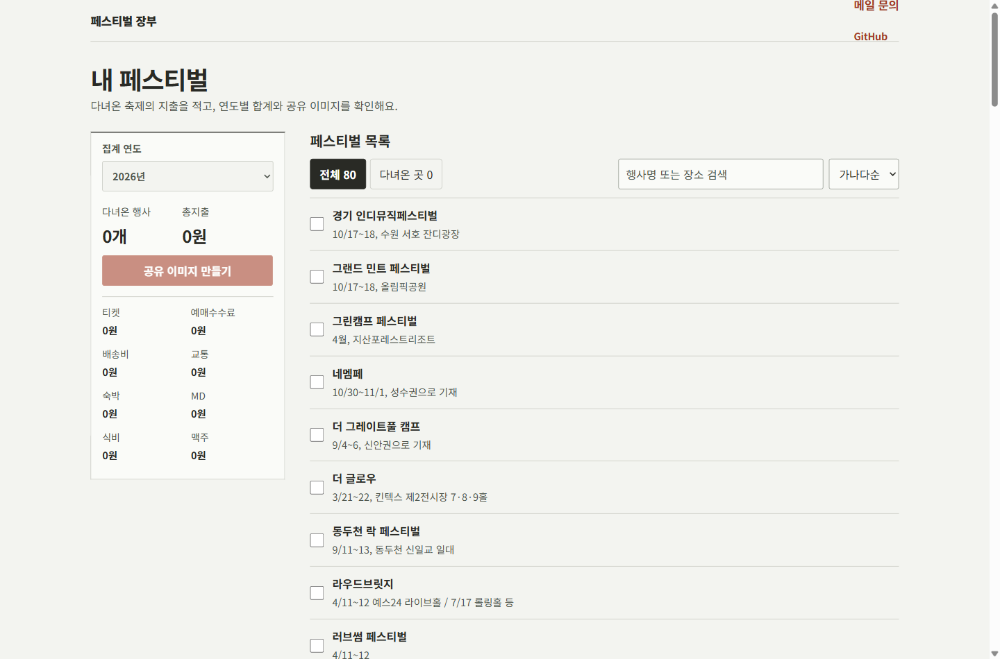

# 페스티벌 장부

다녀온 페스티벌을 체크하고, 티켓부터 교통비와 식비까지 얼마를 썼는지 모아보는 작은 기록장입니다.

**사이트:** https://festival-ledger.kro.kr

## 이렇게 써요

- 다녀온 페스티벌을 체크하고 예매한 티켓 권종을 고르면, 등록된 티켓 가격이 들어갑니다.
- 예매 수수료와 배송비, 교통·숙박·MD·식비를 따로 적을 수 있습니다.
- 맥주는 페스티벌 평균 한 잔 가격에 마신 잔 수를 곱해 계산합니다.
- 연도별 지출을 보고, 다녀온 곳과 쓴 돈을 이미지로 저장해 공유할 수 있습니다.

가입할 필요는 없습니다. 기록은 사용하는 브라우저에 저장되고, 공유 이미지는 기기에서 만들어집니다.

## 문의와 의견

오류나 가격 정보 수정은 [GitHub Issues](https://github.com/gangbin0616/festival-ledger/issues)에 남기거나 [이메일](mailto:gngbn0616@gmail.com)로 보내주세요. 페스티벌 정보 보완과 사용 의견도 환영합니다.

## 사용 안내

정적 웹사이트라 별도 서버 설치 없이 저장소 파일을 웹 호스팅에 올리면 됩니다. 가격과 출처 목록은 `prices.js`, 페스티벌 정보는 `data.json`에 있습니다.
